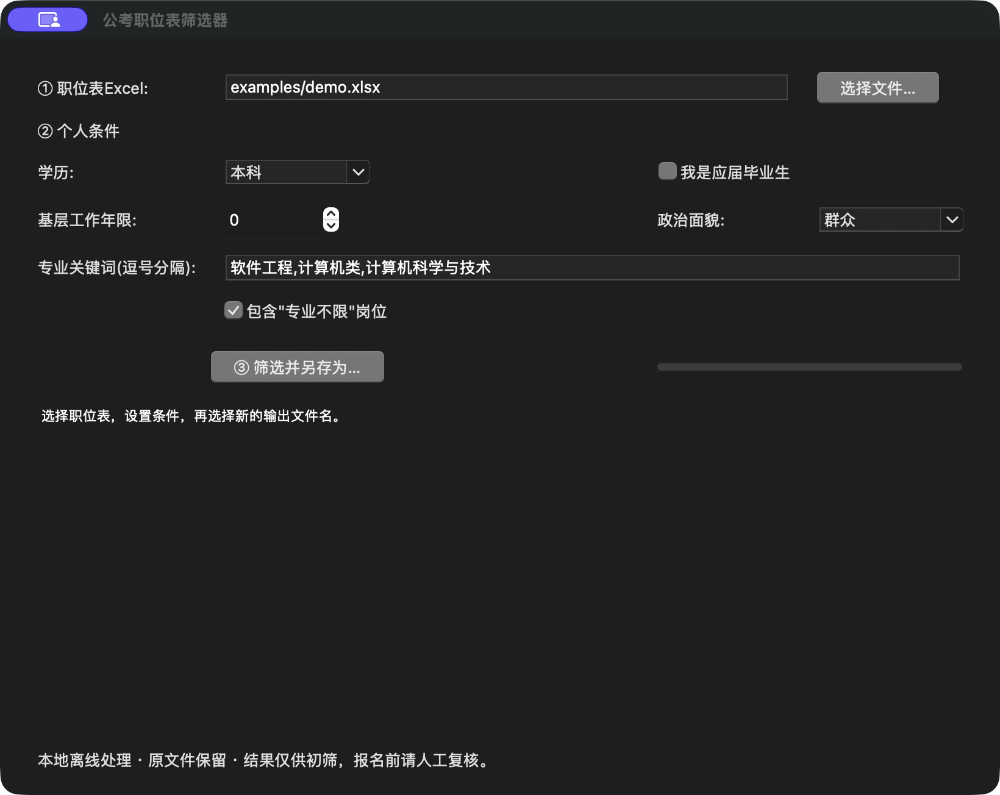

# Job Filter

**Turn a long Excel job list into a short list worth reviewing.**

[中文](README.md) · [Sample input](examples/demo.xlsx) · [Expected output](examples/demo-filtered.xlsx)

A local-first Python utility for Chinese civil-service job spreadsheets, with a desktop UI and a headless CLI. Filter by degree, major keywords, graduate status, work experience, and political affiliation. All sample data is synthetic.



## Quick start

Python 3.10+ is required; the GUI also requires Tcl/Tk 8.6+.

```sh
python -m venv .venv
# Activate the environment, then:
python -m pip install -r requirements.txt
python filter_gui.py
# Or use the CLI:
python filter_cli.py examples/demo.xlsx result.xlsx --degree 本科 --majors 计算机 --years 0
```

The sample keeps two fictional roles: **A · 软件支持** and **D · 综合服务**. The source workbook is never overwritten. Existing output requires explicit overwrite permission. Saving uses a temporary file before replacing the destination.

## Scope

For plain `.xlsx` job lists and simple `.xlsm` workbooks. VBA storage is retained without executing macros. The header must contain both “专业” and “学历” within the first 15 rows. Cell styles, row heights, column widths, and title/header merges are retained for supported sheets.

Workbooks with formulas, charts, images, tables, conditional formatting, validations, named ranges, or merged data rows are rejected to avoid broken references. Keep the original and simplify a copy when necessary.

Matching is heuristic, not an eligibility decision. Read the original recruitment notice before applying. The UI and rule vocabulary are Chinese; this English guide does not imply an English UI.

## Desktop builds

GitHub Actions builds Windows x64 and macOS Apple Silicon packages. Intel Mac users should run from source. Packages are not commercially signed or Apple-notarized. Release candidates are staged as drafts before publication.

## Development

```sh
python -m unittest discover -s tests -v
python scripts/make_example.py
```

[Contributing](CONTRIBUTING.md) · [Security](SECURITY.md) · [Roadmap](docs/ROADMAP.md)

## License

[MIT](LICENSE) © shanghe000. Contributions are welcome.
